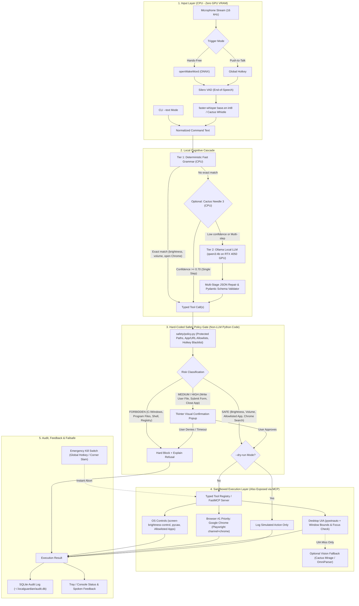
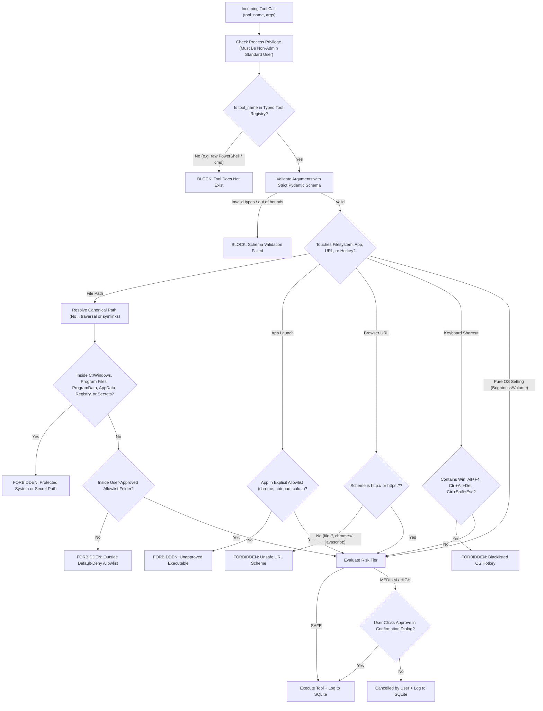
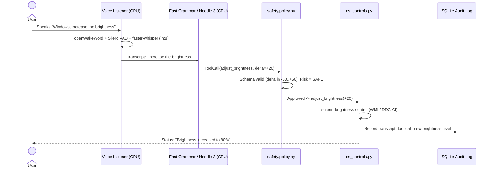
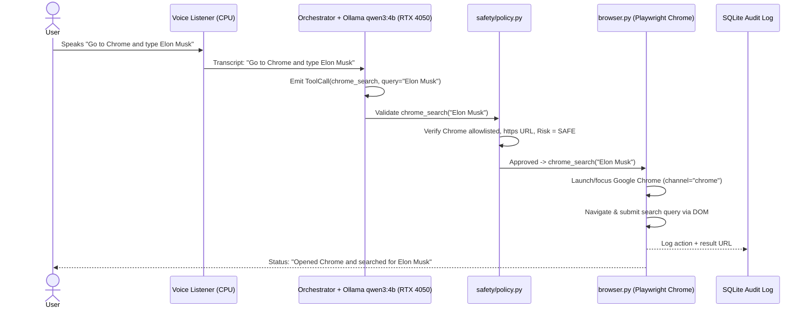
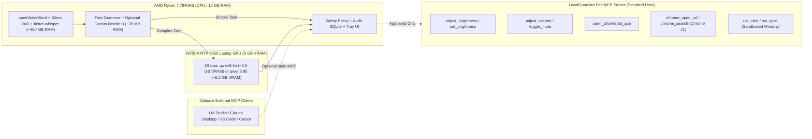
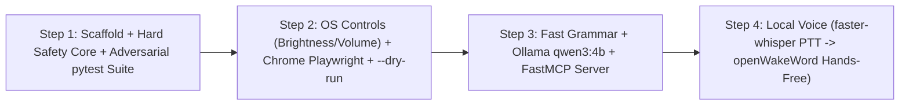

# LocalGuardian — Complete System Architecture & Flowcharts

> **Project:** LocalGuardian (*Voice-Driven Local LLM Agent for Sandboxed Windows OS and Browser Automation*)  
> **Companion Blueprint:** [RESEARCH.md](./RESEARCH.md)

This document maps out everything happening inside **LocalGuardian** from the moment you speak a command to the moment Windows or Google Chrome safely executes it.

---

## 1. End-to-End System Architecture Flowchart

---

## 2. Hard Safety & Sandboxing Decision Flow

Safety is enforced purely in deterministic Python code and Windows OS permissions (**never** relying on LLM prompt obedience).

---

## 3. End-to-End Walkthroughs (Sequence Diagrams)

### Example A: Fast Local OS Control — *"Windows, increase the brightness"*

Runs 100% on CPU in under a second without even needing the GPU LLM.

### Example B: Browser Task (Chrome #1 Priority) — *"Go to Chrome and type Elon Musk"*

Uses the local Ollama model on your RTX 4050 GPU if phrased naturally (or fast grammar for standard phrasing), validates against policy, and drives real Google Chrome via Playwright.

---

## 4. Hardware Split & MCP Ecosystem Topology

How **LocalGuardian** splits workloads across your **Ryzen 7 7840HS + RTX 4050 (6 GB VRAM)** and exposes its sandboxed tools via **Model Context Protocol (MCP)**.

---

## 5. Prototype Build Order (4 Steps)

